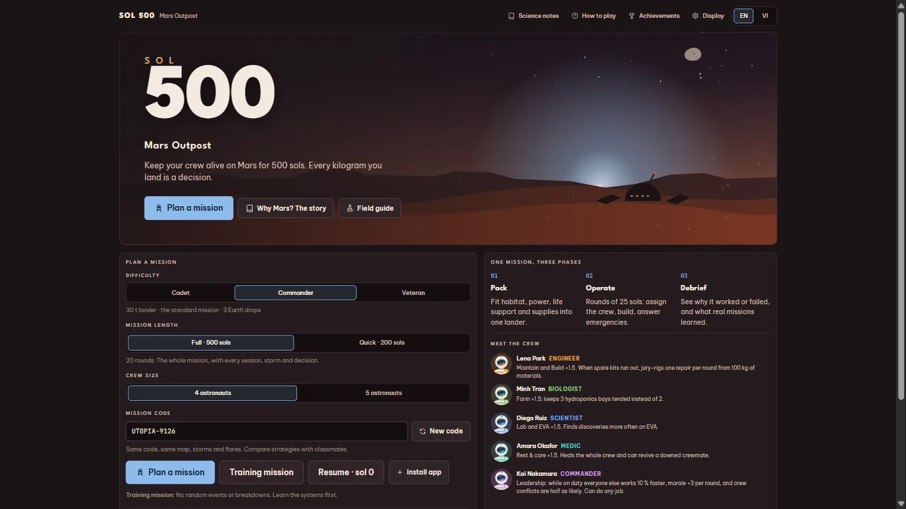
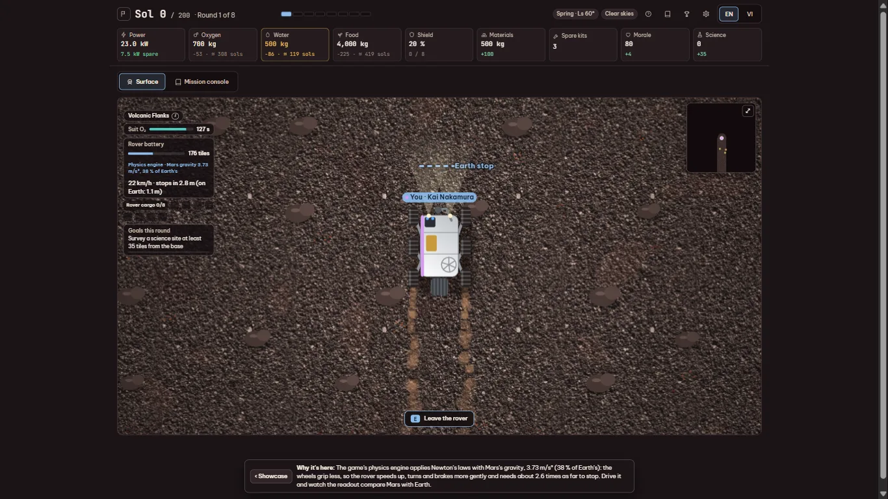
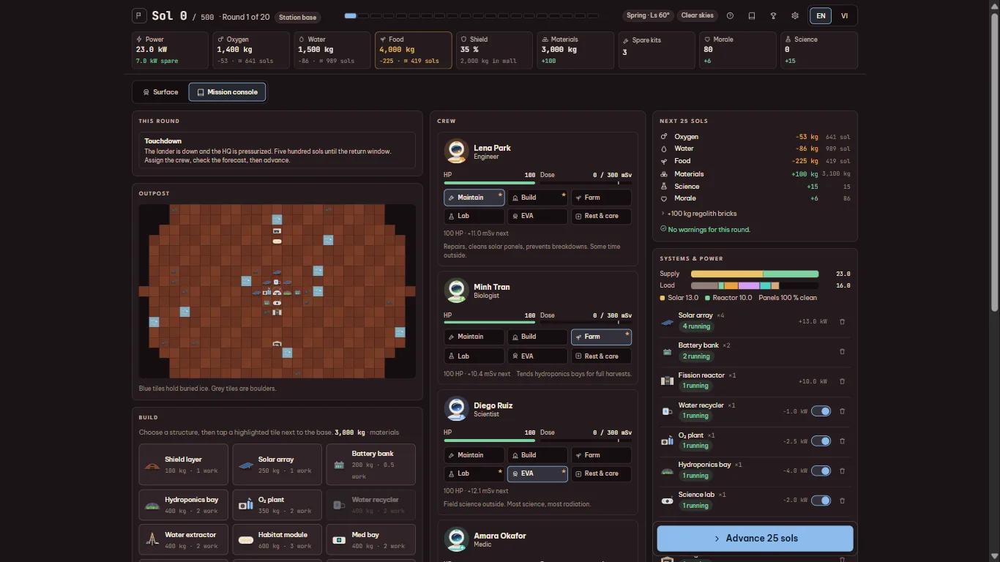
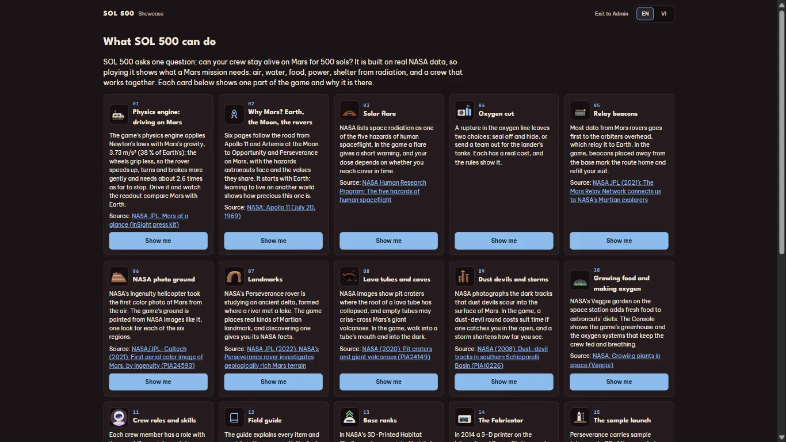

# SOL 500 — Mars Outpost

[](../../releases/latest)
[](LICENSE)


Can your crew stay alive on Mars for 500 sols? SOL 500 is a survival and base-building game for students aged 15–18, built on real NASA numbers. Pack the lander, give your crew their jobs, build the outpost, walk and drive across Mars, and live through dust storms, solar flares and oxygen cuts.



**[Download the Windows installer](../../releases/latest)**, or open `dist/sol500.html` in any browser to play solo.

- **Physics engine:** Newton's laws with Mars gravity (3.73 m/s², 38 % of Earth's). The rover shows live how much further it needs to stop than on Earth.
- **Real science:** dozens of cited NASA sources, NASA photos for the ground, and a Science notes page and field guide in the game.
- **Co-op:** up to 5 players on the same Wi-Fi, or anywhere through a share link.
- **Two languages:** English and Vietnamese.
- **Showcase:** a gallery of feature cards that each jump straight into the real game (Admin → Showcase).

| Driving on Mars: where the rover would stop on Earth and on Mars | The Mission console: crew jobs, the outpost, power, and the next 25 sols |
|---|---|
|  |  |



## Play

| Way | How |
|-----|-----|
| Solo, no install | Open `dist/sol500.html` in a browser. It works offline. |
| Co-op on your network | Install [Node.js](https://nodejs.org), then `npm install` and `npm start`, and open http://localhost:5050. On Windows you can double-click `Play SOL 500.cmd` instead. |
| Windows app | `npm install`, then `npm run app` builds the installer `dist-app/SOL500-Setup-<version>.exe`. |

## Develop

```
npm install
npm test        # the whole suite (node --test)
npm start       # game server on port 5050 (PORT=... to change it)
npm run app:dev # the desktop app, from source
```

`src/` is the game (plain JavaScript that runs straight from source: no framework, and only two runtime packages, `ws` and `qrcode`), `server.js` and `lib/` the co-op server, `app/` the Electron shell, `test/` the tests, and `docs/superpowers/` the design specs and plans each version was built from. What changed in each version: [CHANGELOG.md](CHANGELOG.md).

## License

Made by Tung Son. The code is under the [MIT License](LICENSE). The ground photos and facts come from NASA; the game names the source of each one on its Science notes page.
